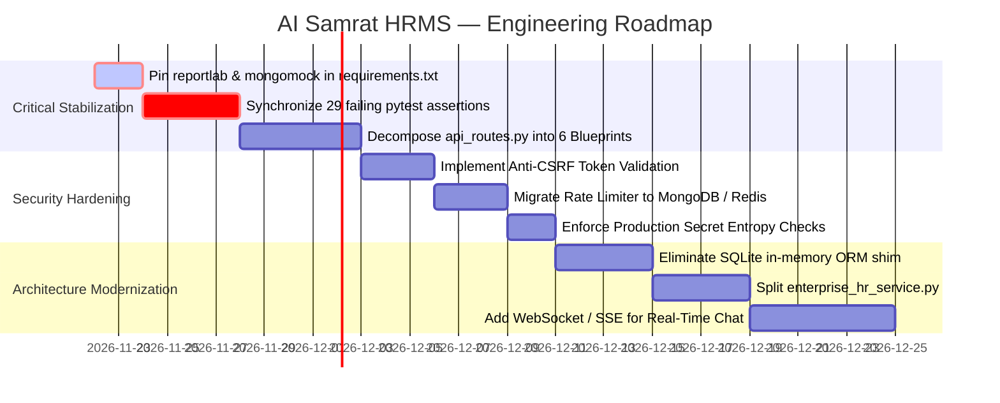

# 14. Project Implementation Status & Development Roadmap

## 1. Verified Module Implementation Status

Every capability within the AI Samrat HRMS has been traced and verified against active source code:

| Module / Subsystem | Verified Status | Key Evidence & File Paths |
| :--- | :--- | :--- |
| **Dual-Tab Authentication** | **COMPLETED** | `backend/routes/auth_routes.py`, `frontend/templates/auth/login.html` |
| **Email / SMTP OTP Activation** | **COMPLETED** | `backend/services/otp_service.py`, `backend/services/external_notification_service.py` |
| **Role-Based Access Control** | **COMPLETED** | `backend/permissions/rbac.py` (enforces canonical roles & IDOR isolation) |
| **IST Attendance Engine** | **COMPLETED** | `backend/services/attendance_service.py` (10:00 AM cutoff, 18:00 qualifying day) |
| **Multi-Session Break Tracking** | **COMPLETED** | `backend/services/attendance_service.py` (`start_break()`, `end_break()`) |
| **Attendance Correction Workflow** | **COMPLETED** | `backend/services/attendance_correction_service.py` |
| **Skill & Competency Matrix** | **COMPLETED** | `backend/services/skill_service.py`, `frontend/templates/skills/skill_matrix.html` |
| **Trainer Assessment Center** | **COMPLETED** | `backend/services/skill_service.py` (1–5 star ratings, verification status) |
| **TL Skill Gap Diagnostics** | **COMPLETED** | `backend/services/skill_service.py` (matrix coverage & recommendations) |
| **Multi-Tier Leave Approvals** | **COMPLETED** | `backend/services/leave_service.py` (TL $\rightarrow$ Manager $\rightarrow$ HR) |
| **Work-from-Home (WFH) Portal** | **COMPLETED** | `backend/services/wfh_service.py` |
| **Overtime Management** | **COMPLETED** | `backend/services/overtime_service.py` (pre-approvals and calculations) |
| **Project & Task Milestones** | **COMPLETED** | `backend/services/project_service.py` (weighted progress tracking) |
| **Daily Work Diary Engine** | **COMPLETED** | `backend/services/work_diary_service.py` (task logging and TL sign-offs) |
| **ReportLab Vector PDF Payslips** | **COMPLETED** | `backend/services/salary_pdf_service.py` (company logo, Platypus tables) |
| **Direct Messaging & Group Chat** | **COMPLETED** | `backend/services/chat_service.py` (1-on-1, rooms, message deletion) |
| **Confidential Grievance Desk** | **COMPLETED** | `backend/services/complaint_service.py` (isolated from managers) |
| **Facilities & Desk Seating** | **COMPLETED** | `backend/services/enterprise_hr_service.py` |
| **IT Hardware Asset Inventory** | **COMPLETED** | `backend/services/enterprise_hr_service.py` |
| **Automated Birthday Greetings** | **COMPLETED** | `backend/services/birthday_service.py`, `backend/scheduler/scheduler.py` |
| **OpenPyXL Excel ZIP Backups** | **COMPLETED** | `backend/services/export_service.py` |
| **Distributed Scheduler Locks** | **COMPLETED** | `backend/scheduler/scheduler.py` (MongoDB atomic lease locks) |
| **Automatic Project Chat Link** | **PARTIAL** | Auto-creation of project chat room during project initialization returns `None`. |
| **Offboarding Project Sync** | **PARTIAL** | Member removal from project does not record employee in `former_members` field. |

---

## 2. Prioritized Engineering Roadmap

### Phase 1: Critical Stabilization & Dependency Hardening (Week 1)
1. **Requirements Update**: Add `reportlab>=5.0.0` and `mongomock>=4.3.0` to `requirements.txt` to eliminate container build failures.
2. **Pytest Suite Alignment**: Update assertions in the 29 failing tests to conform to the canonical 5-role architecture and role-tab security rejections.
3. **Project Chat Channel Hook**: Fix `ProjectService.create_project()` to automatically register the project chat conversation in `chat_conversations`.

### Phase 2: Security & Blueprint Refactoring (Week 2)
1. **Controller Modularization**: Refactor `api_routes.py` (4,540 lines) into six domain-specific Flask blueprints (`attendance_bp`, `leave_bp`, `skill_bp`, `project_bp`, `enterprise_bp`, `admin_bp`).
2. **Distributed Rate Limiting**: Move `LoginRateLimiter` from local process memory to the existing `login_attempts` collection in MongoDB.
3. **Anti-CSRF Protection**: Add synchronizer token verification for all mutating JSON endpoints.

### Phase 3: Architectural Modernization & Performance (Week 3–4)
1. **Eliminate SQLite User Shim**: Replace the in-memory SQLite synchronization bridge in `backend/models/user.py` with pure MongoDB index queries.
2. **Real-Time Communication**: Transition chat messaging from client-side HTTP polling to WebSockets or Server-Sent Events (SSE).
3. **Service Segregation**: Decompose `enterprise_hr_service.py` (2,702 lines) into focused domain services.

